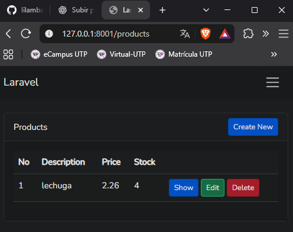
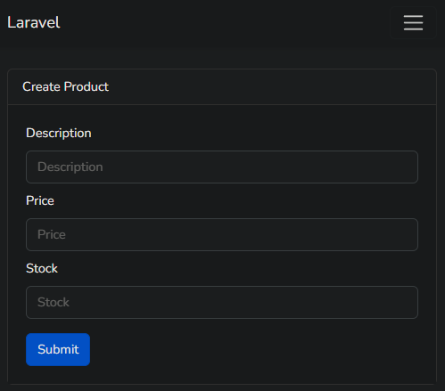
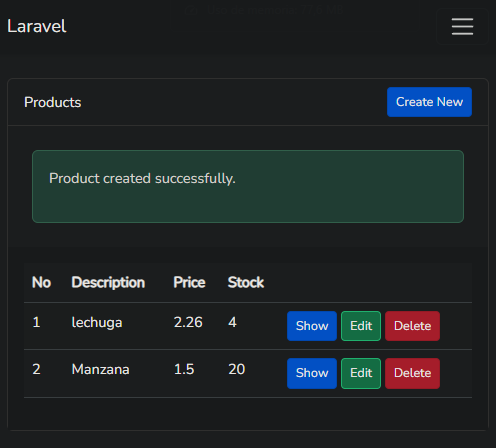
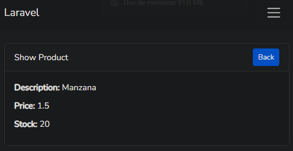
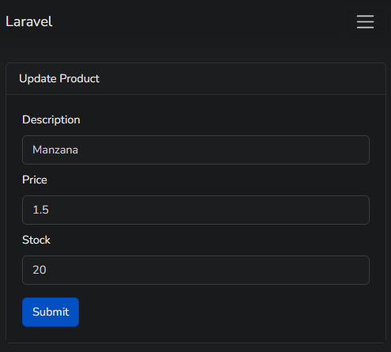
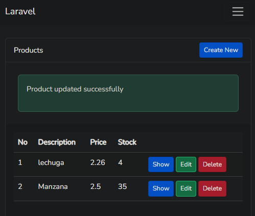
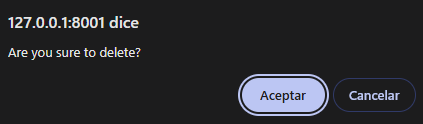
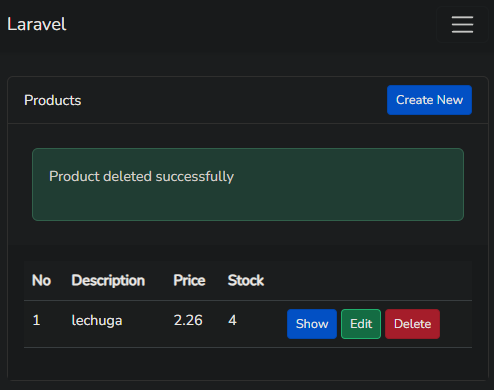
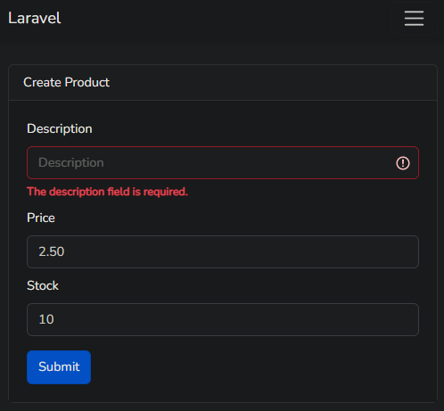

# Laboratorio - Sistema CRUD de productos con Laravel

### Desarrollo Web

Estudiante: Ambar Greco  
Profesora: Irina Fong

---

## 1. Introducción

En este laboratorio se trabajó con el framework Laravel para implementar un sistema web que permite administrar productos mediante las operaciones fundamentales de un CRUD: Create (crear), Read (consultar), Update (actualizar) y Delete (eliminar).

El proyecto utiliza PHP, Laravel, el patrón de arquitectura MVC, el motor de plantillas Blade y Bootstrap para presentar una interfaz que permite interactuar con los productos almacenados en una base de datos.

Durante el desarrollo se revisaron y configuraron las rutas, controladores, modelos, migraciones, formularios y vistas necesarias para el funcionamiento del sistema.

También se realizaron pruebas prácticas para comprobar que los usuarios pueden crear productos, visualizar sus datos, modificar la información registrada y eliminar productos del sistema.

Finalmente, se verificaron las validaciones de los formularios y se documentaron los resultados mediante capturas de pantalla.

## 2. Objetivos

### Objetivo general

Implementar y comprobar el funcionamiento de una aplicación CRUD utilizando Laravel, aplicando los conceptos relacionados con el desarrollo web, la programación PHP, el patrón MVC y la gestión de datos.

### Objetivos específicos

- Comprender la estructura de un proyecto Laravel.
- Identificar las funciones de los modelos, vistas y controladores.
- Configurar rutas para gestionar productos.
- Implementar formularios de creación y edición.
- Consultar los productos registrados.
- Actualizar la información de productos existentes.
- Eliminar registros de la base de datos.
- Aplicar validaciones mediante Form Request.
- Comprobar el funcionamiento mediante pruebas prácticas.
- Documentar el código y los resultados obtenidos.

## 3. Tecnologías utilizadas

| Tecnología | Función |
|---|---|
| Laravel | Framework utilizado para desarrollar la aplicación |
| PHP | Lenguaje utilizado para implementar la lógica del sistema |
| HTML5 | Estructura de las páginas y formularios |
| Bootstrap | Diseño de la interfaz web |
| Blade | Motor de plantillas utilizado para generar las vistas |
| Eloquent ORM | Gestión de los datos mediante modelos |
| Composer | Administración de dependencias PHP |
| Node.js y NPM | Instalación y compilación de recursos frontend |
| Vite | Compilación de CSS y JavaScript |
| Visual Studio Code | Edición y organización del código |
| WAMP | Entorno local de desarrollo |
| Git y GitHub | Control de versiones y publicación del proyecto |

## 4. Descripción general del sistema

La aplicación permite gestionar un conjunto de productos mediante una interfaz web.

Cada producto contiene los siguientes datos:

- Descripción del producto.
- Precio.
- Cantidad disponible en inventario.

El usuario puede consultar la lista de productos y seleccionar diferentes opciones para administrar la información.

Las principales funciones son:

| Operación | Funcionalidad |
|---|---|
| Create | Registrar un producto nuevo |
| Read | Consultar el listado y los detalles de productos |
| Update | Modificar los datos de un producto existente |
| Delete | Eliminar un producto registrado |

Las operaciones se gestionan mediante el controlador `ProductController.php` y el modelo `Product.php`.

## 5. Arquitectura MVC utilizada

Laravel utiliza el patrón Modelo-Vista-Controlador, conocido como MVC.

Esta arquitectura permite separar los componentes de la aplicación según sus responsabilidades.

### 5.1. Modelo

El modelo representa los datos del sistema y permite interactuar con la base de datos.

En este proyecto se utiliza:

`app/Models/Product.php`

El modelo permite crear, consultar, actualizar y eliminar productos mediante Eloquent.

### 5.2. Vista

Las vistas representan las páginas que observa el usuario.

En este proyecto se encuentran en:

`resources/views/product/`

Se utilizan para mostrar la lista de productos, presentar formularios y consultar la información de cada registro.

### 5.3. Controlador

El controlador recibe las solicitudes y coordina las operaciones entre las vistas y los modelos.

En este proyecto se utiliza:

`app/Http/Controllers/ProductController.php`

Este archivo contiene los métodos que permiten ejecutar las operaciones del CRUD.

### 5.4. Flujo de funcionamiento

El funcionamiento general del sistema sigue esta secuencia:

1. El usuario realiza una acción desde el navegador.
2. Laravel identifica la ruta correspondiente.
3. La solicitud llega al método del controlador.
4. El controlador utiliza el modelo para consultar o modificar la información.
5. La base de datos procesa la operación correspondiente.
6. Laravel devuelve una vista o redirige al usuario hacia otra página.

Esta estructura permite mantener una organización clara del código.

---

## 6. Estructura del proyecto

Los principales archivos utilizados para el CRUD son:

| Archivo | Función |
|---|---|
| `routes/web.php` | Define las rutas web |
| `app/Http/Controllers/ProductController.php` | Contiene las operaciones CRUD |
| `app/Http/Requests/ProductRequest.php` | Define las validaciones |
| `app/Models/Product.php` | Representa los productos |
| `database/migrations/2026_10_16_133925_create_products_table.php` | Define la tabla de productos |
| `resources/views/product/index.blade.php` | Lista de productos |
| `resources/views/product/create.blade.php` | Formulario de creación |
| `resources/views/product/edit.blade.php` | Formulario de edición |
| `resources/views/product/show.blade.php` | Detalles de un producto |
| `resources/views/product/form.blade.php` | Campos reutilizables |
| `resources/views/layouts/app.blade.php` | Plantilla general |

Esta organización facilita la localización de cada componente y permite comprender cómo se relacionan las diferentes partes de la aplicación.

## 7. Configuración de las rutas

Las rutas del sistema se encuentran en:

`routes/web.php`

El código utilizado es:

```php
<?php

use Illuminate\Support\Facades\Route;
use Illuminate\Support\Facades\Auth;
use App\Http\Controllers\HomeController;
use App\Http\Controllers\ProductController;

Route::get('/', function () {
    return view('welcome');
});

Auth::routes();

Route::get('/home', [HomeController::class, 'index'])->name('home');

Route::resource('products', ProductController::class);
```

La instrucción principal del CRUD es:

`Route::resource('products', ProductController::class);`

Esta línea registra las rutas necesarias para administrar los productos.

| Método HTTP | Ruta | Acción |
|---|---|---|
| GET | `/products` | Listar productos |
| GET | `/products/create` | Mostrar formulario de creación |
| POST | `/products` | Guardar un producto |
| GET | `/products/{product}` | Consultar un producto |
| GET | `/products/{product}/edit` | Mostrar formulario de edición |
| PUT/PATCH | `/products/{product}` | Actualizar un producto |
| DELETE | `/products/{product}` | Eliminar un producto |

Gracias a `Route::resource`, no es necesario escribir individualmente las siete rutas del CRUD.

Las rutas de productos están declaradas directamente, sin un middleware de autenticación aplicado a ese grupo. La protección del acceso puede incorporarse posteriormente como una mejora de seguridad.

---

## 8. Modelo Product

El modelo de productos se encuentra en:

`app/Models/Product.php`

Este modelo utiliza Eloquent para comunicarse con la base de datos.

La configuración principal es:

```php
class Product extends Model
{
    protected $perPage = 20;

    protected $fillable = [
        'description',
        'price',
        'stock'
    ];
}
```

### 8.1. Paginación

La propiedad `$perPage = 20` establece el número predeterminado de registros por página cuando se utiliza la paginación del modelo.

Esto permite organizar los productos cuando existe una cantidad considerable de registros.

### 8.2. Campos asignables

La propiedad `$fillable` establece qué atributos pueden asignarse masivamente al crear o actualizar un producto.

En este proyecto los campos permitidos son:

- `description`
- `price`
- `stock`

Esta configuración permite utilizar métodos como `create()` y `update()` para almacenar la información validada.

---

## 9. Migración de productos

Las migraciones permiten administrar la estructura de las tablas de la base de datos mediante código PHP.

La migración utilizada se encuentra en:

`database/migrations/2026_10_16_133925_create_products_table.php`

El código principal es:

```php
public function up(): void
{
    Schema::create('products', function (Blueprint $table) {
        $table->id();
        $table->string('description');
        $table->double('price', 8, 2);
        $table->integer('stock');
        $table->timestamps();
    });
}
```

### 9.1. Campos de la tabla

| Campo | Tipo | Descripción |
|---|---|---|
| `id` | BIGINT | Identificador único |
| `description` | VARCHAR | Descripción del producto |
| `price` | DOUBLE(8,2) | Precio del producto |
| `stock` | INTEGER | Existencias disponibles |
| `created_at` | TIMESTAMP | Fecha de creación |
| `updated_at` | TIMESTAMP | Fecha de actualización |

### 9.2. Método up()

El método `up()` crea la tabla `products` con sus respectivos campos.

### 9.3. Método down()

El método `down()` permite revertir la migración mediante la eliminación de la tabla.

```php
public function down(): void
{
    Schema::dropIfExists('products');
}
```

Las migraciones facilitan la reproducción de la estructura de la base de datos en diferentes entornos.

---

## 10. Controlador ProductController

El controlador principal se encuentra en:

`app/Http/Controllers/ProductController.php`

Este archivo contiene siete métodos encargados de administrar los productos.

### 10.1. Método index()

```php
public function index(Request $request): View
{
    $products = Product::paginate();

    return view('product.index', compact('products'))
        ->with('i', ($request->input('page', 1) - 1) * $products->perPage());
}
```

Este método obtiene los productos registrados mediante `Product::paginate()`.

Después envía la información a la vista `product.index`, donde se presenta el listado.

También calcula el número inicial utilizado para enumerar los productos cuando existen varias páginas.

### 10.2. Método create()

```php
public function create(): View
{
    $product = new Product();

    return view('product.create', compact('product'));
}
```

Crea una instancia vacía del modelo y muestra el formulario de registro.

### 10.3. Método store()

```php
public function store(ProductRequest $request): RedirectResponse
{
    Product::create($request->validated());

    return Redirect::route('products.index')
        ->with('success', 'Product created successfully.');
}
```

Este método recibe la información del formulario, utiliza `ProductRequest` para validarla y crea un nuevo producto.

Después redirige al listado y muestra un mensaje de confirmación.

### 10.4. Método show()

```php
public function show($id): View
{
    $product = Product::find($id);

    return view('product.show', compact('product'));
}
```

Busca un producto mediante su identificador y envía los datos a la vista de detalles.

### 10.5. Método edit()

```php
public function edit($id): View
{
    $product = Product::find($id);

    return view('product.edit', compact('product'));
}
```

Recupera el producto seleccionado y abre el formulario con sus datos actuales.

### 10.6. Método update()

```php
public function update(ProductRequest $request, Product $product): RedirectResponse
{
    $product->update($request->validated());

    return Redirect::route('products.index')
        ->with('success', 'Product updated successfully');
}
```

Valida los nuevos datos y actualiza el producto.

Finalmente, regresa al listado con un mensaje que confirma la operación.

### 10.7. Método destroy()

```php
public function destroy($id): RedirectResponse
{
    Product::find($id)->delete();

    return Redirect::route('products.index')
        ->with('success', 'Product deleted successfully');
}
```

Busca el producto seleccionado, lo elimina y redirige al listado con un mensaje de confirmación.

Estos siete métodos permiten gestionar las cuatro operaciones fundamentales del CRUD.

---

## 11. Validaciones del formulario

Las validaciones se encuentran en:

`app/Http/Requests/ProductRequest.php`

El archivo contiene las siguientes reglas:

```php
public function rules(): array
{
    return [
        'description' => 'required|string',
        'price' => 'required',
        'stock' => 'required',
    ];
}
```

Las reglas permiten verificar la información antes de crear o actualizar un producto.

| Campo | Regla | Función |
|---|---|---|
| `description` | `required|string` | Exige una descripción de texto |
| `price` | `required` | Exige ingresar un precio |
| `stock` | `required` | Exige ingresar una cantidad |

El archivo también contiene:

```php
public function authorize(): bool
{
    return true;
}
```

Este método permite que las solicitudes superen la comprobación de autorización del formulario.

Es importante mencionar que las reglas actuales de precio y stock solo comprueban que estos campos tengan valores. No incluyen todavía una validación explícita para verificar que el precio sea numérico o que el stock sea un número entero no negativo.

---

## 12. Vistas del sistema

Las vistas se encuentran en:

`resources/views/product/`

### 12.1. index.blade.php

Muestra la lista de productos registrados en una tabla.

Incluye las columnas de descripción, precio y stock, además de los botones necesarios para consultar, editar y eliminar productos.

También contiene el botón `Create New`, utilizado para abrir el formulario de registro.

La vista utiliza `@foreach` para recorrer los productos y muestra mensajes de confirmación cuando se completa correctamente una operación.

### 12.2. create.blade.php

Contiene el formulario utilizado para registrar productos nuevos.

El formulario envía los datos a la ruta `products.store` mediante el método POST.

También utiliza `@csrf` para incluir la protección correspondiente contra solicitudes falsificadas.

### 12.3. edit.blade.php

Permite actualizar un producto previamente registrado.

Utiliza la ruta `products.update` y el método HTTP PATCH, representado mediante `method_field('PATCH')`.

El formulario presenta los datos actuales del producto para facilitar su modificación.

### 12.4. form.blade.php

Este archivo contiene los campos reutilizables de los formularios.

Incluye los campos:

- Description.
- Price.
- Stock.

También utiliza `old()` para conservar los valores ingresados cuando ocurre un error de validación.

Gracias a `@error` y `$errors->first()`, se pueden presentar mensajes relacionados con los campos que no cumplen las reglas establecidas.

### 12.5. show.blade.php

Muestra individualmente la información de un producto registrado.

Presenta la descripción, el precio y el stock del producto seleccionado.

También incluye el botón `Back`, utilizado para regresar al listado principal.

---

## 13. Pruebas de funcionamiento del CRUD

Para comprobar el sistema se realizaron pruebas de creación, consulta, actualización, eliminación y validación.

Los resultados se documentaron mediante nueve capturas de pantalla.

### 13.1. Visualización de productos

Primero se ingresó a la dirección local del listado de productos.

`http://127.0.0.1:8001/products`

En esta página se visualizó la tabla con los productos registrados.

El sistema mostró las columnas correspondientes a descripción, precio y stock, junto con las opciones `Show`, `Edit`, `Delete` y `Create New`.



### 13.2. Formulario de creación

Se seleccionó el botón `Create New` para abrir el formulario de registro.

El sistema mostró los campos necesarios para agregar un producto.



### 13.3. Registro de un producto

Para comprobar la operación Create, se registró un producto con los siguientes valores:

| Campo | Valor |
|---|---|
| Description | Manzana |
| Price | 1.50 |
| Stock | 20 |

Después de presionar `Submit`, Laravel guardó el producto y mostró el mensaje `Product created successfully`.

El nuevo registro apareció en el listado junto con los demás productos.



### 13.4. Consulta de un producto

Para comprobar la operación Read, se seleccionó el botón `Show` correspondiente al producto Manzana.

El sistema mostró sus datos individuales:

- Description: Manzana.
- Price: 1.5.
- Stock: 20.

También se mostró el botón `Back` para regresar al listado.



### 13.5. Formulario de edición

Se seleccionó el botón `Edit` correspondiente al producto Manzana.

Laravel recuperó los datos existentes y los mostró dentro del formulario de actualización.

Esto permitió comprobar que el formulario se carga con la información actual del producto.



### 13.6. Actualización del producto

Para comprobar la operación Update, se modificaron los siguientes datos:

| Campo | Valor anterior | Valor nuevo |
|---|---|---|
| Description | Manzana | Manzana |
| Price | 1.50 | 2.50 |
| Stock | 20 | 35 |

Después de presionar `Submit`, el sistema mostró el mensaje `Product updated successfully`.

El listado reflejó correctamente el nuevo precio y la nueva cantidad disponible.



### 13.7. Confirmación de eliminación

Para comprobar la operación Delete, se seleccionó el botón rojo `Delete`.

El navegador mostró un mensaje de confirmación antes de eliminar el producto.

La confirmación permite cancelar la operación si el usuario no desea continuar.



### 13.8. Eliminación del producto

Después de confirmar la eliminación, Laravel eliminó el registro de Manzana.

El sistema mostró el mensaje `Product deleted successfully`.

También se comprobó que el producto ya no aparecía en el listado, mientras que los demás registros permanecían disponibles.



### 13.9. Prueba de validación

Finalmente, se realizó una prueba para comprobar el comportamiento del formulario ante información incompleta.

Se dejó vacío el campo `Description`, mientras que los demás campos contenían valores.

Al intentar registrar el producto, Laravel mostró el mensaje:

`The description field is required.`

El sistema impidió completar el registro y conservó los valores válidos introducidos anteriormente.



---

## 14. Resumen de las pruebas

| Prueba | Resultado |
|---|---|
| Mostrar listado de productos | Correcto |
| Abrir formulario de creación | Correcto |
| Registrar producto | Correcto |
| Consultar producto | Correcto |
| Abrir formulario de edición | Correcto |
| Actualizar producto | Correcto |
| Solicitar confirmación de eliminación | Correcto |
| Eliminar producto | Correcto |
| Validar descripción obligatoria | Correcto |

Las nueve pruebas documentadas permitieron comprobar el funcionamiento de las principales opciones del sistema.

## 15. Instalación y ejecución del proyecto

Para reproducir el proyecto en otro equipo es necesario preparar un entorno compatible con Laravel.

Se necesitan PHP, Composer, Node.js, NPM y una base de datos compatible con la configuración de la aplicación.

### 15.1. Descargar el repositorio

El proyecto se encuentra disponible en:

https://github.com/lilambaru/Laboratorio-CRUD-Laravel

Puede descargarse como archivo ZIP o clonarse mediante Git.

Comando de clonación:

```bash
git clone https://github.com/lilambaru/Laboratorio-CRUD-Laravel.git
```

### 15.2. Abrir el proyecto

Desde la terminal se accede a la carpeta descargada:

```bash
cd Laboratorio-CRUD-Laravel
```

### 15.3. Instalar las dependencias PHP

```bash
composer install
```

Composer instalará las dependencias definidas en el proyecto.

### 15.4. Configurar el entorno

Crear el archivo `.env` a partir de `.env.example`.

En PowerShell se puede utilizar:

```powershell
Copy-Item .env.example .env
```

Después se genera la clave de la aplicación:

```bash
php artisan key:generate
```

### 15.5. Configurar la base de datos

En el archivo `.env` se debe configurar la conexión correspondiente a la base de datos utilizada.

Para trabajar con MySQL en WAMP, por ejemplo, se debe establecer `DB_CONNECTION=mysql` y configurar el servidor, puerto, nombre de la base de datos, usuario y contraseña.

La base de datos indicada debe existir y la configuración debe coincidir con los datos del entorno local.

No deben publicarse contraseñas ni claves privadas en GitHub.

### 15.6. Ejecutar las migraciones

Una vez configurada la base de datos se ejecuta:

```bash
php artisan migrate
```

Esto permite crear las tablas definidas en las migraciones, incluida la tabla de productos.

### 15.7. Instalar las dependencias frontend

En Windows PowerShell se puede utilizar:

```powershell
npm.cmd install
```

Posteriormente, se compilan los recursos:

```powershell
npm.cmd run build
```

### 15.8. Iniciar el servidor

Para ejecutar la aplicación en el puerto utilizado durante las pruebas:

```bash
php artisan serve --port=8001
```

La aplicación podrá abrirse desde:

http://127.0.0.1:8001

Para acceder al listado de productos:

http://127.0.0.1:8001/products

---

## 16. Seguridad y buenas prácticas

El proyecto utiliza diferentes mecanismos propios de Laravel para organizar y procesar las solicitudes.

Entre ellos se encuentran:

- Protección CSRF en los formularios.
- Validación de datos mediante `ProductRequest`.
- Uso de Eloquent para acceder a los registros.
- Separación entre modelos, vistas y controladores.
- Confirmación antes de eliminar productos.
- Archivo `.gitignore` para excluir determinados archivos privados y dependencias.

Estas funcionalidades contribuyen a mantener una estructura más organizada.

Sin embargo, la aplicación todavía puede mejorarse incorporando reglas de validación más estrictas, restricciones de acceso y un manejo más robusto de registros inexistentes.

## 17. Posibles mejoras

Como futuras mejoras del proyecto se consideran las siguientes:

1. Validar que el precio sea numérico y no negativo.
2. Comprobar que el stock sea un número entero no negativo.
3. Agregar límites de longitud a las descripciones.
4. Proteger las rutas de productos mediante autenticación y autorización.
5. Gestionar correctamente los casos en los que un producto no existe.
6. Incorporar un buscador de productos.
7. Permitir ordenar los productos por precio, descripción o cantidad.
8. Añadir pruebas automatizadas para las operaciones CRUD.
9. Mejorar la confirmación visual de eliminación.
10. Utilizar un tipo decimal apropiado para representar importes monetarios.

Estas mejoras permitirían aumentar la seguridad, precisión y facilidad de uso de la aplicación.

---

## 18. Resultados obtenidos

El desarrollo del laboratorio permitió implementar y comprobar las cuatro operaciones principales de un sistema CRUD utilizando Laravel.

Se logró registrar productos nuevos, visualizar su información, modificar los datos existentes y eliminar registros.

También se comprobó el funcionamiento de las validaciones mediante una prueba en la que se intentó registrar un producto sin completar su descripción.

Las capturas de pantalla permitieron documentar el comportamiento de la aplicación antes y después de ejecutar cada operación.

Además, el análisis de las rutas, modelos, controladores, migraciones y vistas permitió comprender cómo se relacionan los diferentes componentes de Laravel.

## 19. Conclusión

Mediante el desarrollo de este laboratorio se fortalecieron los conocimientos relacionados con la creación de aplicaciones web utilizando Laravel y PHP.

La implementación del sistema CRUD permitió comprender cómo se gestionan los datos mediante las operaciones de creación, consulta, actualización y eliminación.

También se aplicaron conceptos relacionados con el patrón MVC, el uso de Eloquent, la configuración de rutas, el diseño de formularios con Blade y Bootstrap, y la validación de datos mediante Form Request.

Las pruebas realizadas permitieron verificar que las principales funcionalidades respondían correctamente, mientras que la documentación mediante capturas facilitó la presentación de los resultados obtenidos.

Finalmente, el uso de Git y GitHub permitió organizar y publicar el código fuente del proyecto junto con sus evidencias, facilitando su revisión y reproducción como parte del aprendizaje de desarrollo web.

## 20. Referencias

- Laravel. Documentación oficial: https://laravel.com/docs
- PHP. Documentación oficial: https://www.php.net/docs.php
- Bootstrap. Documentación oficial: https://getbootstrap.com/docs/
- Composer. Documentación oficial: https://getcomposer.org/doc/
- Git. Documentación oficial: https://git-scm.com/doc
- GitHub Docs: https://docs.github.com/
